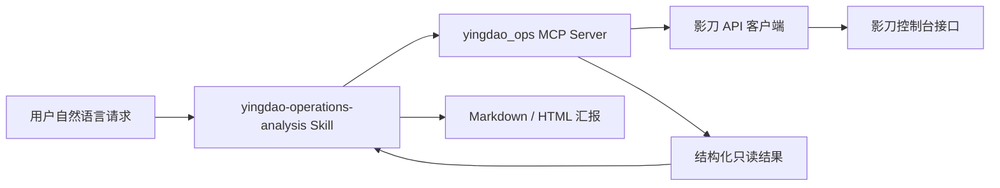

# Yingdao Ops MCP

面向影刀（ShadowBot）控制台运行数据的只读 MCP Server 与 Codex Skill。项目封装登录认证、执行记录、任务详情、应用统计、运行时长和异常聚合能力，让智能体可以通过自然语言查询运行情况并生成结构化汇报。

> 本项目使用影刀控制台的非公开接口，仅用于已获授权账号的内部运维分析。接口路径和响应字段可能随平台升级发生变化。

## 功能

- 自动登录并在进程内缓存 `access_token`
- 查询应用执行记录和执行状态
- 获取任务开始时间、结束时间与异常说明
- 按日期统计应用运行次数和运行时长
- 查询租户总运行数据与每日运行趋势
- 按异常任务 `startTime` 聚合错误、应用和机器人排行
- 为每类高频错误生成对应的处理建议
- 提供 Markdown 和单文件 HTML 汇报模板
- 对 MCP 返回结果自动移除常见敏感字段

## 架构



Skill 负责日期解释、工具选择、数据汇总和报告格式；MCP Server 负责认证、接口请求、参数校验和敏感信息清理。

## 环境要求

- Node.js 18 或更高版本
- npm
- 可访问 `https://api.yingdao.com`
- 已获授权的影刀账号
- 支持 MCP 的客户端（使用 MCP 时）

项目当前使用 Node.js 22 验证。

## 快速开始

### 1. 安装依赖

```powershell
git clone <your-repository-url>
cd yingdao-ops-mcp
npm install
```

### 2. 配置认证信息

复制环境变量模板：

```powershell
Copy-Item .env.example .env
```

编辑 `.env`，选择明文密码或 RSA 加密密码方式。

```env
YINGDAO_USERNAME=your-account
YINGDAO_PASSWORD=your-password
YINGDAO_BASIC_AUTH=base64-client-credentials
```

推荐使用加密密码：

```env
YINGDAO_USERNAME=your-account
YINGDAO_ENCRYPTED_PASSWORD=your-rsa-encrypted-password
YINGDAO_BASIC_AUTH=base64-client-credentials
```

也可以临时使用已有 Token：

```env
YINGDAO_ACCESS_TOKEN=your-access-token
```

`YINGDAO_BASIC_AUTH` 是影刀登录接口使用的客户端 Basic 凭据，不是账号密码的 Base64 编码。

### 3. 验证

```powershell
npm test
npm run verify-mcp
```

只验证登录且不打印 Token：

```powershell
npm run auth
```

## MCP 配置

MCP Server 入口为 `src/mcp-server.mjs`。Codex 配置示例：

```toml
[mcp_servers.yingdao_ops]
command = "node"
args = [
  "--env-file-if-exists=D:/path/to/yingdao-ops-mcp/.env",
  "D:/path/to/yingdao-ops-mcp/src/mcp-server.mjs"
]
cwd = "D:/path/to/yingdao-ops-mcp"
enabled = true
required = false
startup_timeout_sec = 20
tool_timeout_sec = 180
```

将示例中的路径替换为本机绝对路径。修改 `.env` 或 MCP 配置后，重启 MCP 客户端使配置生效。

## MCP 工具

所有工具均为只读操作。

| 工具 | 功能 | 主要参数 |
|---|---|---|
| `list_execution_records` | 分页查询执行记录 | `page`、`size`、`statusList` |
| `get_exception_details` | 查询执行实例下的任务详情 | `sceneInstUuid`、`robotClientUuid` |
| `get_app_statistics` | 查询应用运行次数、时长和负责人 | 日期范围、分页参数 |
| `get_runtime_total` | 汇总指定日期范围的运行次数和时长 | 开始日期、结束日期 |
| `get_daily_runtime` | 查询最近 N 天每日运行时长 | `days` |
| `analyze_recent_errors` | 聚合异常应用、机器人和错误原因 | `startDate`、`endDate`、`top` |

### 异常统计时间口径

`analyze_recent_errors` 最终以任务详情中的 `startTime` 判断任务是否属于统计周期，而不是以执行实例的 `createTime` 作为最终筛选条件。

- 日期范围包含开始日和结束日
- 时区使用 `Asia/Shanghai`
- “最近 7 天”表示今天和之前 6 个自然日
- 异常时长由任务 `startTime` 到 `endTime` 计算

执行实例 `createTime` 仅用于发现候选记录和控制分页范围。

## Skill

Skill 源码位于：

```text
skills/yingdao-operations-analysis/
```

显式调用示例：

```text
$yingdao-operations-analysis 汇总最近 10 天运行异常数据
```

也可以直接使用自然语言：

- 统计最近 7 天运行过的应用
- 汇总最近 10 天运行异常数据
- 哪个机器人异常最多
- 分析最近失败次数最多的错误原因
- 统计最近 30 天每天的运行时长

Skill 不保存账号、密码或 Token。认证信息始终由 MCP Server 从 `.env` 或进程环境变量读取。

## 使用案例

以下案例均为虚构数据，仅用于展示智能体的使用方式和返回格式。

### 案例 1：汇总最近运行异常

用户请求：

```text
汇总最近 10 天运行异常数据
```

智能体会调用 `analyze_recent_errors`，按异常任务 `startTime` 统计并返回：

```text
统计范围：2026-01-01 至 2026-01-10
异常任务：42 次
受影响应用：6 个
受影响机器人：3 个
错误类型：9 种
异常运行时长：12.6 小时

高频错误：
1. 页面元素未找到：15 次，建议更新定位器并增加备用定位规则
2. 浏览器窗口失联：9 次，建议执行前重新获取窗口和页面对象
3. 接口请求超时：6 次，建议增加分级超时和指数退避重试
```

### 案例 2：统计运行过的应用

用户请求：

```text
统计最近 7 天运行过的应用，按运行次数排序
```

智能体会调用 `get_app_statistics`，读取全部分页并过滤 `runCount > 0`：

| 排名 | 应用 | 负责人 | 运行次数 | 运行时长 |
|---:|---|---|---:|---:|
| 1 | 示例-订单同步 | 示例用户甲 | 60 | 420.00 |
| 2 | 示例-库存检查 | 示例用户乙 | 40 | 310.50 |
| 3 | 示例-报表生成 | 示例用户甲 | 20 | 130.00 |

> 运行时长接口未返回单位时，报告会保留 API 原始值，不擅自转换为小时或分钟。

### 案例 3：查看每日运行趋势

用户请求：

```text
统计最近 7 天每天的运行时长，并指出峰值日期
```

智能体会调用 `get_daily_runtime`，排除基线点后计算周期数据：

| 日期 | 当日运行时长 | 较前一日变化 |
|---|---:|---:|
| 2026-01-05 | 130.00 | +13.0% |
| 2026-01-06 | 155.00 | +19.2% |
| 2026-01-07 | 130.00 | -16.1% |

示例结论：1 月 6 日为周期峰值，最后一天较峰值回落 16.1%。

### 案例 4：排查单次执行失败

用户请求：

```text
查看执行记录 demo-inst-002 在 DEMO-BOT-B 上的异常详情
```

智能体会调用 `get_exception_details`：

| 任务 | 状态 | 开始时间 | 结束时间 | 错误说明 |
|---|---|---|---|---|
| demo-job-001 | 完成 | 09:10:01 | 09:10:06 | - |
| demo-job-002 | 异常 | 09:10:06 | 09:10:20 | 示例数据库连接超时 |

推荐处理：检查数据库网络可达性和连接池状态，为短暂连接失败增加有限次数重试。

### 案例 5：生成 HTML 汇报

用户请求：

```text
将最近 7 天异常数据整理成可以嵌入 HTML 编辑器的汇报
```

智能体查询数据后，可以按照 [`report-examples.html`](skills/yingdao-operations-analysis/references/report-examples.html) 的布局生成单文件 HTML。页面使用内嵌 CSS，不依赖外部脚本或样式资源。

## CLI 使用

不使用 MCP 时，可以直接调用 CLI。

查询异常执行记录：

```powershell
node src/ops-cli.mjs execution-records '{"page":1,"size":10,"statusList":["error"]}'
```

查询任务详情：

```powershell
node src/ops-cli.mjs exception-details '{"sceneInstUuid":"instance-id","robotClientUuid":"robot-id","page":1,"size":10}'
```

查询应用统计：

```powershell
node src/ops-cli.mjs app-statistics '{"page":1,"size":100,"startStatisticDate":"2026-01-01","endStatisticDate":"2026-01-07","sortBy":"3"}'
```

查询运行汇总：

```powershell
node src/ops-cli.mjs runtime-total '{"startStatisticDate":"2026-01-01","endStatisticDate":"2026-01-07"}'
```

查询每日运行时长：

```powershell
node src/ops-cli.mjs daily-runtime '{"days":7}'
```

通过 MCP 调用完整异常聚合：

```powershell
$json = @{ startDate='2026-01-01'; endDate='2026-01-07'; top=20 } | ConvertTo-Json -Compress
$base64 = [Convert]::ToBase64String([Text.Encoding]::UTF8.GetBytes($json))
node scripts/call-mcp.mjs analyze_recent_errors "base64:$base64"
```

## 汇报模板

Skill 内置六类报告模板：

- 执行记录汇报
- 执行任务详情汇报
- 应用运行统计汇报
- 运行总汇
- 每日运行趋势汇报
- 应用运行异常汇报

相关文件：

| 文件 | 用途 |
|---|---|
| [`report-templates.md`](skills/yingdao-operations-analysis/references/report-templates.md) | Markdown 模板及字段占位符 |
| [`report-examples.md`](skills/yingdao-operations-analysis/references/report-examples.md) | 完全虚构的 Markdown 示例 |
| [`report-examples.html`](skills/yingdao-operations-analysis/references/report-examples.html) | 可嵌入 HTML 编辑器的单文件示例 |

示例文件不包含真实应用、机器人、账号或运行数据。

## 项目结构

```text
yingdao-ops-mcp/
|-- src/
|   |-- yingdao-auth.mjs       # 登录、密码加密和 Token 管理
|   |-- yingdao-api.mjs        # 影刀 API 客户端
|   |-- yingdao-analysis.mjs   # 异常聚合分析
|   |-- mcp-server.mjs         # MCP Server 与工具注册
|   |-- auth-cli.mjs           # 登录验证 CLI
|   `-- ops-cli.mjs            # 业务查询 CLI
|-- scripts/
|   |-- call-mcp.mjs           # 通用 MCP 工具调用
|   |-- verify-mcp.mjs         # MCP 握手与查询验证
|   |-- import-capture-env.mjs # 从登录请求生成本地环境变量
|   `-- report-*.mjs           # 独立统计脚本
|-- skills/
|   `-- yingdao-operations-analysis/
|       |-- SKILL.md
|       |-- agents/openai.yaml
|       `-- references/        # 报告模板和虚构示例
|-- test/                      # Node.js 自动化测试
|-- templates/                 # 项目级报告模板
|-- .env.example
|-- package.json
`-- README.md
```

## API 对应关系

| 能力 | 请求方式 | 路径 |
|---|---|---|
| 临时请求凭据 | GET | `/api/noauth/requestCredential/get` |
| 登录认证 | POST | `/oauth/token/v2` |
| 执行记录 | POST | `/api/dispatch/v3/scene/inst/page` |
| 任务详情 | GET | `/api/dispatch/v2/scene/inst/job/list` |
| 应用统计 | POST | `/api/console/statistic/data/appList` |
| 运行汇总 | POST | `/api/console/statistic/data/appListTotal` |
| 每日运行时长 | POST | `/api/console/statistic/data/tenant/days` |

POST 请求会自动获取临时 `X-Credential`。登录成功后，Token 仅在进程内缓存，不会由 MCP 工具返回。

## 测试

```powershell
npm test
```

测试覆盖：

- RSA 密码加密与登录响应解析
- Token 获取和包装响应兼容
- POST 请求临时凭据
- 执行记录和任务详情请求参数
- 应用统计与运行时长接口
- 按任务 `startTime` 的异常聚合
- MCP 工具注册、调用和错误处理

## 安全

- `.env` 已加入 `.gitignore`
- 不要提交 HAR、Cookie、Token、账号或密码
- 不要在 Issue、日志或截图中公开认证请求头
- MCP 会过滤 `access_token`、`password`、`authorization`、`cookie` 和 `x-credential`
- 截图、云日志和录屏地址视为敏感运维数据，仅按需展示
- 建议使用最低权限的专用账号

上传 GitHub 前建议执行：

```powershell
git status --short
git ls-files .env
rg -n "Bearer |access_token|YINGDAO_PASSWORD=" --glob "!package-lock.json"
```

`git ls-files .env` 应无输出。敏感信息扫描出现结果时，应逐项确认并移除真实凭据。

## 已知限制

- 影刀控制台接口并非公开稳定 API，平台升级后可能需要调整字段或路径
- `runTime` 相关响应未提供明确单位，工具会保留 API 原始数值
- 每日运行时长接口通常返回一个基线点，周期合计必须排除该点
- 异常分析需要逐个请求任务详情，大范围查询可能耗时较长
- 详情请求失败时，报告会显示失败数量，结果可能存在少量遗漏
- 新安装或更新 MCP、Skill 后通常需要重启客户端

## License

发布前请根据实际使用场景补充合适的开源许可证，例如 MIT、Apache-2.0 或内部专用许可证。
